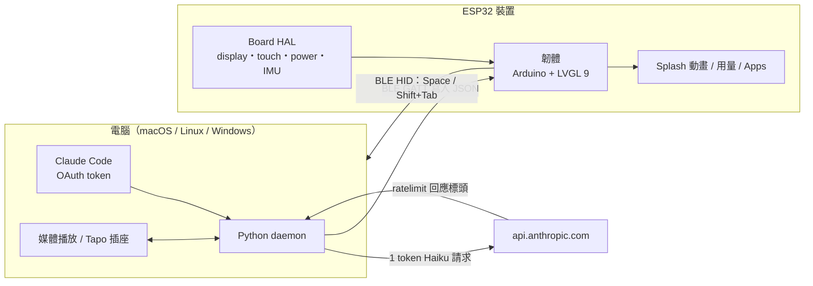

<div align="center">


# Clawdmeter

**放在桌上的 ESP32 小螢幕：即時顯示 Claude Code 用量，兼當 BLE 快捷鍵與迷你 App 平台**


</div>

---

## 📖 簡介

Clawdmeter 是一台放在桌邊的 Claude Code 用量儀表板。電腦上的 daemon 讀取 Claude Code 的 OAuth token，用一次極小的 API 呼叫從回應標頭取得 5 小時 / 每週用量，再透過藍牙寫到 ESP32 的 AMOLED 螢幕上。開機畫面播放像素風的 Clawd 動畫，用量升得越快動畫越忙；側邊按鍵則透過 BLE HID 送出 Space 與 Shift+Tab，對應 Claude Code 的語音模式與模式切換。

> 這是 fork 自 Hermann Björgvin Haraldsson 的 Clawdmeter，原始的硬體、韌體與 daemon 設計都來自原作者。

## ✨ 功能特色

- 📊 **用量儀表**：Session（5 小時）與 Weekly 使用率、重置倒數
- 🦀 **Clawd 動畫**：依用量變化速度切換動畫群組，每 20 秒自動輪播
- ⌨️ **實體快捷鍵**：BLE HID 鍵盤送出 Space（語音 push-to-talk）與 Shift+Tab
- 🖥️ **多板支援**：7 款 Waveshare ESP32-S3 / C6 AMOLED / LCD 板，加上桌面 SDL2 模擬器
- 💻 **跨平台 daemon**：macOS（launchd）、Linux（systemd）、Windows（系統匣圖示 + 開機自啟）

本 fork 新增：

- 🏠 **App 啟動器**：時鐘首頁、App 格狀選單、上滑回首頁
- 🎵 **Now Playing**：顯示並控制電腦正在播放的音樂
- 🔌 **Smart Plug**：透過 Windows daemon 控制 TP-Link Tapo 智慧插座
- ⚙️ **Settings**、📈 **Spectrum** App
- 🚀 **效能**：釋放內部 RAM、內部 RAM 繪圖緩衝、更順的捲動

## 🏗️ 系統架構



## 🧰 技術棧

| 層 | 技術 |
| --- | --- |
| 韌體 | C++、Arduino（pioarduino ESP32）、PlatformIO、LVGL 9、Arduino_GFX、SensorLib、XPowersLib |
| 硬體 | ESP32-S3 / ESP32-C6、AMOLED（CO5300 / SH8601）與 LCD（ST7789 / ST7701）面板 |
| 通訊 | BLE GATT（自訂資料服務）+ BLE HID 鍵盤 |
| Daemon | Python（bleak 等），launchd / systemd / Windows 系統匣 |
| 模擬器 | SDL2 native build（`pio run -e sim`） |
| 工具 | Node.js 腳本：官方 Clawd sprite 與 Lucide 圖示轉 LVGL C 陣列 |

## 📂 專案結構

```text
Clawdmeter/
├── firmware/
│   ├── src/
│   │   ├── boards/<name>/    # 每塊板子一個資料夾（含 sim 模擬器）
│   │   ├── hal/              # display / touch / input / power / IMU 介面
│   │   └── main.cpp ui.cpp splash.cpp …
│   └── platformio.ini        # 每塊板子一個 [env:…]
├── daemon/                 # 用量 daemon（macOS / Linux / Windows 系統匣、Tapo、Now Playing）
├── tools/                  # 動畫與圖示轉換腳本
├── research/clawd-official/  # 官方 Clawd 素材與出處
├── docs/                   # 移植指南、字型
├── install*.sh / install-windows.ps1 / flash*.sh
└── SIM-USAGE.md            # 桌面模擬器說明
```

## 📱 Screens

The device boots into the splash. Tap the screen anywhere to switch to the Usage view; tap again to flip back to the splash.

|              Splash               |              Usage              |
| :-------------------------------: | :-----------------------------: |
|  |  |
|   Splash; touch-toggle anytime    | Session and weekly utilization  |

While the splash is up, the middle (PWR) button cycles animations. **Hold the power button for 3 seconds, then release, to put the device into pairing mode** — this clears the saved Bluetooth bond and re-advertises. The firmware also auto-rotates animations every 20 s within the current usage-rate group, so a long stretch on the splash isn't just one Clawd on loop.

## 🔧 Hardware

Boards supported out of the box:

- [Waveshare ESP32-S3-Touch-AMOLED-2.16](https://www.waveshare.com/esp32-s3-touch-amoled-2.16.htm?&aff_id=149786)
- [Waveshare ESP32-C6-Touch-AMOLED-2.16](https://www.waveshare.com/esp32-c6-touch-amoled-2.16.htm?&aff_id=149786)
- [Waveshare ESP32-S3-Touch-AMOLED-1.8](https://www.waveshare.com/esp32-s3-touch-amoled-1.8.htm?&aff_id=149786)
- [Waveshare ESP32-C6-Touch-AMOLED-1.8](https://www.waveshare.com/esp32-c6-touch-amoled-1.8.htm?&aff_id=149786)
- [Waveshare ESP32-S3-Touch-AMOLED-2.06](https://www.waveshare.com/esp32-s3-touch-amoled-2.06.htm?&aff_id=149786)
- [Waveshare ESP32-S3-Touch-LCD-1.54](https://www.waveshare.com/esp32-s3-lcd-1.54.htm?sku=33869&aff_id=149786)
- [Waveshare ESP32-S3-Touch-LCD-4](https://www.waveshare.com/esp32-s3-touch-lcd-4.htm)

> Please check if a pull request exists for your alternative hardware port before opening a new one, providing QA feedback and testing on the same hardware is more valuable than duplicate pull requests.

**Porting to another board:** the firmware is a thin HAL with per-board folders under `firmware/src/boards/`. Drop in a new folder and a new PlatformIO env — `main.cpp`, `ui.cpp`, and `splash.cpp` never need to change. See [`docs/porting/adding-a-board.md`](docs/porting/adding-a-board.md) for the walk-through and [`docs/porting/hal-contract.md`](docs/porting/hal-contract.md) for the interfaces a port must implement.

## 📋 Prerequisites

- Linux (tested on Ubuntu), macOS, or Windows 10/11
- [PlatformIO CLI](https://docs.platformio.org/en/latest/core/installation/index.html)
- Linux: `curl`, `bluetoothctl`, `busctl`, `dbus-monitor` (BlueZ Bluetooth stack), `python3`, `setsid`, `stdbuf` (util-linux / coreutils), `systemctl` (systemd user services)
- macOS: `python3` (the installer sets up a venv with `bleak` and `httpx`)
- Windows: `python3` 3.11+ (the installer sets up a venv with `bleak`, `httpx`, and `pystray`)
- Claude Code with an active subscription

## 🍎 macOS installation

The macOS host pieces — Python daemon, LaunchAgent, and flash helper — were ported by [Chris Davidson (@lorddavidson)](https://github.com/lorddavidson). Thanks Chris!

### Flash the firmware

```bash
./flash-mac.sh waveshare_amoled_216                       # ESP32-S3 2.16" (auto-detects /dev/cu.usbmodem*)
./flash-mac.sh waveshare_amoled_216_c6                    # ESP32-C6 2.16" variant
./flash-mac.sh waveshare_amoled_18  /dev/cu.usbmodem1101  # ESP32-S3 1.8" (or pass an explicit USB serial port)
```

The board env name is required. Run `./flash-mac.sh` with no args to see the available envs (scraped from `firmware/platformio.ini`).

### Pair the device

After flashing, open **System Settings → Bluetooth** and click _Connect_ next to "Clawdmeter". The daemon only ever connects to the peripheral this Mac is paired/connected to — it never scans for a nearby device — so once it's connected here the daemon picks it up on its next poll (~60 s).

### Install the daemon

The daemon reads your Claude OAuth token from the macOS Keychain (service `Claude Code-credentials`), polls usage every 60 s, and pushes it to the display over BLE.

```bash
./install-mac.sh
```

The installer creates a Python venv in `daemon/.venv/`, installs `bleak` and `httpx`, renders a LaunchAgent into `~/Library/LaunchAgents/com.user.claude-usage-daemon.plist`, and loads it. The first run is launched interactively so macOS prompts for Bluetooth permission.

Useful commands:

```bash
launchctl list | grep claude-usage                                          # check it's running
tail -F ~/Library/Logs/claude-usage-daemon.out.log                          # live logs
launchctl unload ~/Library/LaunchAgents/com.user.claude-usage-daemon.plist  # stop
launchctl load -w ~/Library/LaunchAgents/com.user.claude-usage-daemon.plist # start
```

## 🐧 Linux installation

### Flash the firmware

```bash
./flash.sh waveshare_amoled_216                  # ESP32-S3 2.16" (defaults to /dev/ttyACM0)
./flash.sh waveshare_amoled_216_c6               # ESP32-C6 2.16" variant
./flash.sh waveshare_amoled_18  /dev/ttyACM1     # ESP32-S3 1.8" (or pass an explicit USB serial port)
```

The board env name is required. Run `./flash.sh` with no args to see the available envs (scraped from `firmware/platformio.ini`).

### Pair the device

After flashing, the device advertises as "Clawdmeter". Pair it once:

```bash
# Scan for the device
bluetoothctl scan le

# When "Clawdmeter" appears, pair and trust it
bluetoothctl pair F4:12:FA:C0:8F:E5    # use your device's MAC
bluetoothctl trust F4:12:FA:C0:8F:E5
```

To re-pair later, hold the power button for 3 seconds then release — the device clears its saved bond and re-advertises.

### Install the daemon

The daemon polls your Claude usage every 60 seconds and sends it to the display over BLE.

```bash
./install.sh
systemctl --user start claude-usage-daemon
```

Check status: `systemctl --user status claude-usage-daemon`

View logs: `journalctl --user -u claude-usage-daemon -f`

To change the poll interval, set `poll_interval = <seconds>` in `~/.config/claude-usage-monitor/config` (see `daemon/config.example`). The daemon picks it up without a restart. Polling slower than ~80s is fine: between polls the daemon replays the last payload every `heartbeat_interval` seconds (default 60) with the reset countdowns aged, so the firmware's 90s freshness window never lapses and no reflash is needed.

## 🪟 Windows installation

Runs natively on Windows — no WSL required. A system-tray app polls your usage and pushes it over BLE, and starts automatically at login.

### Prerequisites

- **Native Windows** (not WSL).
- **Python 3.11+** from [python.org](https://www.python.org/downloads/) — check _"Add python.exe to PATH"_ during install.
- **Claude Code** installed, with `claude login` completed. The token is read from `%USERPROFILE%\.claude\.credentials.json` (falling back to `%LOCALAPPDATA%\Claude\` then `%APPDATA%\Claude\`).
- The repo on a **native Windows path** (e.g. `%USERPROFILE%\Clawdmeter`), **not** a `\\wsl$` share — the installer refuses a WSL path.

### Flash the firmware

```powershell
pio run -d firmware -e waveshare_amoled_216 -t upload --upload-port COM5   # use your device's COM port
```

Run `pio run -d firmware` with no env to see the available board envs.

### Pair the device

The device is a bonded BLE HID keyboard, so pair it once: **Settings → Bluetooth & devices → Add device → Bluetooth**, then select "Clawdmeter". Pairing is **required** — it enables the physical buttons and keeps a persistent connection (the device keeps showing your last-synced usage even after the daemon quits). To undo, use **Remove device** (this disables the buttons).

### Install the daemon (recommended)

From the repo root in PowerShell:

```powershell
powershell -ExecutionPolicy Bypass -File install-windows.ps1
```

This creates a venv, installs `bleak`/`httpx`/`pystray`/`Pillow` from the in-repo requirements (no internet downloads), registers a per-user login-autostart entry (`HKCU\…\Run`, no admin needed), and launches the tray app headlessly (no console window).

### Run manually instead (optional)

```powershell
python -m venv .venv
.venv\Scripts\Activate.ps1        # if blocked: Set-ExecutionPolicy -Scope CurrentUser RemoteSigned, then retry
pip install -r daemon\requirements-windows.txt
python daemon\claude_usage_daemon_windows.py        # runs in the foreground; Ctrl+C to stop
```

### Tray icon and menu

The icon's corner bubble shows state — **green** Connected, **amber** Scanning, **red** Error — and hovering shows the status (`Connected · last update HH:MM`). A notification fires once when it enters Error (e.g. an expired token). Right-click for the menu:

- **Status header** — live state + last sync time.
- **Start at login** — toggle autostart on/off.
- **Quit** — stops the daemon cleanly; leaves the Windows pairing intact (device keeps its last reading).

### Logs and troubleshooting

```powershell
Get-Content $env:LOCALAPPDATA\Clawdmeter\daemon.log -Tail 30        # view logs
reg delete "HKCU\Software\Microsoft\Windows\CurrentVersion\Run" /v Clawdmeter /f   # remove autostart
```

| Symptom                                | Fix                                                      |
| -------------------------------------- | -------------------------------------------------------- |
| `Device not found`                     | Power on the device; make sure it's in range and paired. |
| `token expired` toast / `API HTTP 401` | Re-run `claude login`, then restart the daemon.          |
| `Connection failed`                    | Toggle Windows Bluetooth off/on in Settings.             |
| `Warning: running under Linux/WSL`     | Run from a native PowerShell window, not a WSL shell.    |

## ⚙️ How it works


1. The daemon reads your Claude Code OAuth token — from the macOS Keychain (service `Claude Code-credentials`) on macOS, or from `~/.claude/.credentials.json` on Linux (`%USERPROFILE%\.claude\.credentials.json` on Windows).
2. It makes a minimal API call to `api.anthropic.com/v1/messages` — one token of Haiku, basically free.
3. The usage numbers come straight out of the response headers (`anthropic-ratelimit-unified-5h-utilization` and friends).
4. The daemon connects to the ESP32 over BLE and writes a JSON payload to the GATT RX characteristic.
5. The firmware parses it and updates the LVGL dashboard.
6. The firmware also tracks the rate of change of session % over a 5-minute window and picks splash animations from the matching mood group.
7. The two side buttons are independent of all of this — they send Space and Shift+Tab as BLE HID keyboard input to the paired host directly.

## 🔘 Physical buttons

The board has three side buttons. Left and right send HID keys; the middle (PWR) button cycles splash animations and, held for 3 seconds, triggers pairing mode.

| Button           | GPIO         | Function                                                     |
| ---------------- | ------------ | ------------------------------------------------------------ |
| **Left**         | GPIO 0       | Hold to send Space (Claude Code voice-mode push-to-talk)     |
| **Middle** (PWR) | AXP2101 PKEY | On splash: cycle animations. Hold 3s + release: pairing mode |
| **Right**        | GPIO 18      | Press to send Shift+Tab (Claude Code mode toggle)            |

Space and Shift+Tab go out as standard BLE HID keyboard reports, so they trigger in whatever window has focus on the paired host — not just Claude Code.

## 📡 BLE protocol

The device advertises a custom GATT service alongside the standard HID keyboard service:

|                            | UUID                                   |
| -------------------------- | -------------------------------------- |
| **Data Service**           | `4c41555a-4465-7669-6365-000000000001` |
| RX Characteristic (write)  | `4c41555a-4465-7669-6365-000000000002` |
| TX Characteristic (notify) | `4c41555a-4465-7669-6365-000000000003` |
| **HID Service**            | `00001812-0000-1000-8000-00805f9b34fb` |

JSON payload format (written to RX):

```json
{ "s": 45, "sr": 120, "w": 28, "wr": 7200, "st": "allowed", "ok": true }
```

Fields: `s` = session %, `sr` = session reset (minutes), `w` = weekly %, `wr` = weekly reset (minutes), `st` = status, `ok` = success flag.

## 🛠️ Development


- **Desktop simulator** — iterate on the UI without hardware: an SDL2 window
  runs the full firmware loop with scenario playback (`pio run -d firmware -e
sim`, then `cd firmware && .pio/build/sim/program`). See
  [`SIM-USAGE.md`](SIM-USAGE.md) for controls, scenarios, and headless
  screenshots.
- **Splash animations** — Anthropic's official Clawd sprites, archived with
  provenance notes in [`research/clawd-official/`](research/clawd-official/);
  `node tools/convert_official_clawd.js` regenerates
  `firmware/src/splash_animations.h`. See [`tools/README.md`](tools/README.md).
- **Icons** — Lucide PNGs convert to LVGL C arrays with
  `tools/png_to_lvgl.js`. See [`tools/README.md`](tools/README.md).
- **Fonts** — the pre-compiled LVGL fonts and the LVGL-9 patching they need:
  [`docs/fonts.md`](docs/fonts.md).
- **Porting** — [`docs/porting/adding-a-board.md`](docs/porting/adding-a-board.md)
  and [`docs/porting/hal-contract.md`](docs/porting/hal-contract.md).

## 🙏 Credits

- Original project by Hermann Björgvin Haraldsson and contributors. Also check out [Beam](https://github.com/notaharness/beam) — a CLI that lets you pair your machines using a passkey and [@Tailscale's tailcat](https://tailscale.com/blog/tailcat).
- Pixel-art Clawd animations are Anthropic's official mascot art (claude.ai/code, Claude Code desktop), archived and converted by the tooling in `tools/` and `research/clawd-official/`.
- Lucide icon set ([lucide.dev](https://lucide.dev), MIT) for bluetooth and battery UI glyphs.
- Anthropic brand fonts (Tiempos Text, Styrene B) — see licensing warning below.

## ⚠️ Licensing gray area warning

The software in this repository uses and adheres to the Anthropic brand guidelines and uses the same proprietary fonts that Anthropic has a license for but this software uses without permission as well as using assets from Anthropic such as the copyrighted Clawd mascot so even though the code in this repo is non-proprietary I will not license it myself under a copyleft license since this repo includes proprietary fonts and copyrighted assets. Please be aware of this if you fork or copy the code from this repo. **You have been warned!**
